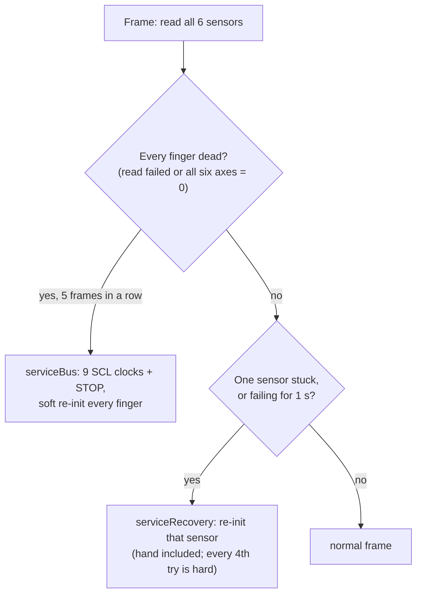

# 09 - Firmware Hardening (v5)

**Phase 7.5/8, make a long capture session survive faults without a reboot.**

**Status: written only. NOT compiled, flashed or tested on the glove.** Compile it in the Arduino IDE first; expect possible small fixes.

Stage 08's v4 firmware was good at *noticing* faults: it flagged a frozen sensor, dropped bad readings from the validity mask, and unwedged a jammed I²C bus at boot. A review on 2026-10-06 found four places where it noticed a fault but could not get out of it. During a 30-minute labelling session any of them means stopping, power-cycling the glove and recalibrating. v5 fixes those four, plus three smaller BLE and power issues (fixes 14-16). The BLE frame is byte-for-byte the same, so the dashboard works with either version.

**Firmware:** [`09_firmware_hardening.ino`](09_firmware_hardening.ino). Flash it the same way as stage 08. Stage 08's sketch stays as it was, as the record.

## The fixes

| # | v4 problem | v5 behaviour |
|---|---|---|
| 10 | A bus that jammed mid-session stayed dead until reboot. `i2cRecover()` only ran during boot init. | If **every** finger reads dead for 5 frames in a row (100 ms), unjam the bus and re-initialise every finger. Logged as `# BUS: ...` and counted in `bus_rec=`. |
| 11 | The recovery loop started at sensor 1, so the hand IMU (sensor 0) was never re-initialised. | The loop starts at 0. A soft attempt re-runs the library's `begin()`. Every 4th attempt is hard and power-cycles the chip through its power pin first. |
| 12 | The hand read could never fail. `readFloatAccelX()` and friends return a float, with no error. | One 12-byte burst read with a byte-count check, same scaling as before. |
| 13 | `bleuart.write()`'s return value was ignored. | Failed writes are counted (`tx_fail=` on the report line). Nothing is written until the dashboard has subscribed. The report line prints the current MTU. |
| 14 | The advertised name was cut to `HandR`. Flags, TX power and the 128-bit UART service UUID use 24 of the advertising packet's 31 bytes, and the name needs 14. | The name moves to the scan response (`Bluefruit.ScanResponse.addName()`), a second 31-byte packet. The service UUID stays in the advertising packet. |
| 15 | The MTU was only logged in the connect callback, before the MTU exchange had happened, so it usually read 23. | Bluefruit has no MTU callback, but `Bluefruit.setEventCallback()` sees every raw BLE event. The sketch catches the MTU exchange there and prints `# BLE mtu negotiated=N` once. |
| 16 | `loop()` returned straight away when the next 20 ms tick wasn't due, so the CPU spun flat out between frames. | It now `delay()`s for the time left. On this core `delay()` is a FreeRTOS `vTaskDelay()`, so the CPU can sleep while BLE keeps running. Same 50 Hz schedule. |

There is also one smaller change: a sensor whose reads keep **failing** for 1 s now gets re-initialised. v4 only re-initialised sensors whose output had **frozen**, so one that NACKed every read stayed out of the mask forever. These sensors are listed under `failing=` on the report line.

Fix 14 also means the dashboard can stop using `acceptAllDevices` in the browser's device picker and filter by the UART service UUID or the name `HandRig-6IMU` instead. That change lives in the dashboard, not here.

**Why `delay()` is fine here but `while(!Serial)` is not.** Both wait, but `while(!Serial)` waits for a USB host that never shows up on battery, so it hangs forever. The `delay()` in `loop()` waits for a time the sketch computed, at most 20 ms, so it always ends. And because it is `vTaskDelay()` underneath, the BLE task keeps running during the wait. The old `return` never blocked, but it never let the CPU sleep either: `yield()` only hands over to tasks of equal or higher priority, and the idle task that sleeps the chip is lower.

## Two things learned from reading the driver code

**A jammed bus doesn't look like failed reads.** The usual cause of a jammed I²C bus is a sensor that got reset halfway through sending a byte and is still holding the data line (SDA) low. The nRF52's I²C hardware takes a low line during the acknowledge bit to mean "acknowledged". So with SDA stuck low, every write "succeeds" and every read returns `0x00`. If v5 only counted failed transactions, it would never see the jam. That's why a read where all six axes are exactly zero now counts as dead. A real IMU at rest always reads about 1 g of gravity, so six zeros is never a real reading.

**The hand IMU is on a different bus.** On the XIAO Sense, the onboard LSM6DS3 is wired to the internal bus `Wire1` (pins 16/17), not to `Wire` (D4/D5), where the mux and the fingers are. The Seeed library quietly does `#define Wire Wire1` for this board. Two consequences:
- v4 sent `tcaDisable()` to the mux before every hand read. That command went out on the finger bus and did nothing for the hand. It's removed.
- A jammed finger bus can't take the hand down, so the bus check only looks at fingers.

## Not covered (open decision)

If a device holds the **clock** line (SCL) low instead of SDA, the nRF52 `Wire` driver waits forever inside `endTransmission()` (its wait loops have no timeout). `loop()` never runs again, so no recovery code can run. The only way out is the nRF52's hardware watchdog: if the loop stops feeding it, it reboots the chip. The cost is that a reboot drops the BLE link and the dashboard has to recalibrate, so it trades a dead glove for a 2-3 s gap plus a recalibration. That's a real tradeoff, so it's left for a DECISIONS.md entry rather than slipped in here.

## How to test it on the glove

1. Flash, open the Serial Monitor at 115200, and check the boot diagnostic matches stage 08 (all 6 `OK`).
2. Connect the dashboard. A `# BLE mtu negotiated=N` line should appear once, shortly after `# BLE connected`, with N at 83 or more (247 is the most this config allows). The report line should then show the same `mtu=` and `tx_fail=0`. If the negotiated line never appears and `mtu=23`, the browser never asked for a bigger MTU.
3. **Advertised name:** with the glove powered and not connected, scan with a phone BLE app such as nRF Connect. It should list the full name `HandRig-6IMU`, not `HandR`, and show the Nordic UART service UUID.
4. **No busy-wait:** the report line should still read `hz=` about 50.0 with no drift, same as stage 08. If you can, compare battery current or board temperature against stage 08 over a few minutes; v5 should draw less between frames.
5. **Bus recovery:** with the glove streaming, touch a jumper from the finger bus SDA (D4) to GND for about a second, then let go. This is safe: the pull-up resistor limits the current. Expect every finger to drop out, a `# BUS: ... bus recovery #1` line, and the fingers to come back without a reboot. If the board stops printing entirely, the driver hung. Note that down, because it settles the watchdog decision.
6. **Hand recovery:** harder to trigger on purpose. Watch `failing=` and `# re-init sid 0` lines during a long session.

## Toolchain

Same as stage 08: **Seeed nRF52 Boards 1.1.13** (board *Seeed XIAO nRF52840 Sense*) and Seeed Arduino LSM6DS3 **2.0.7**. Not compiled yet: an `arduino-cli` build attempt on 2026-10-19 stalled in library detection and was stopped.
