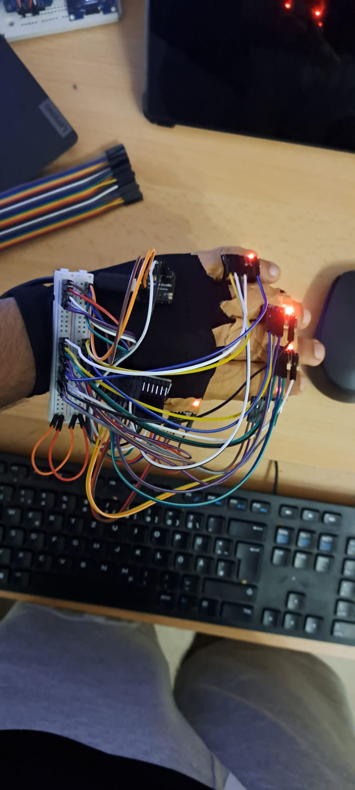
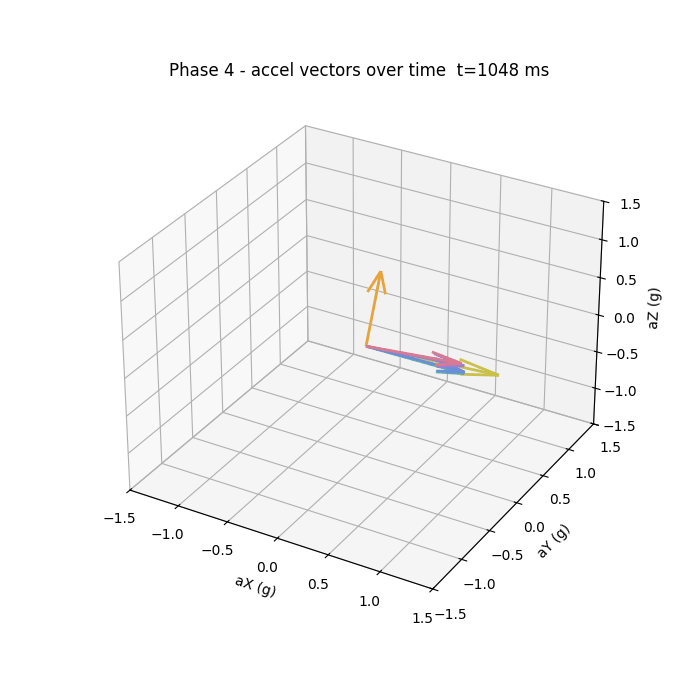
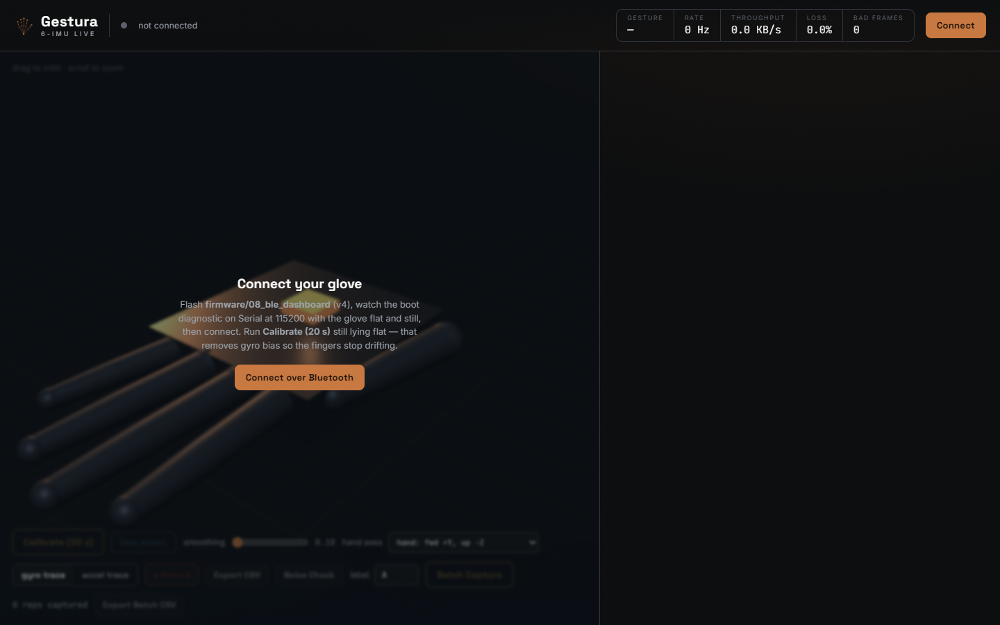
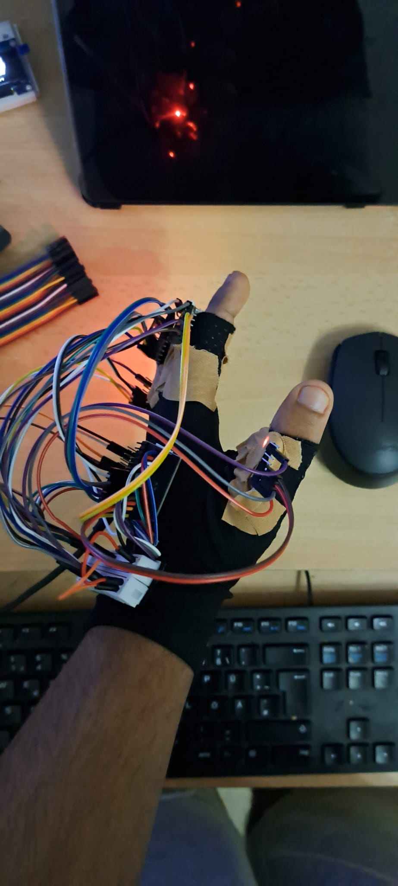
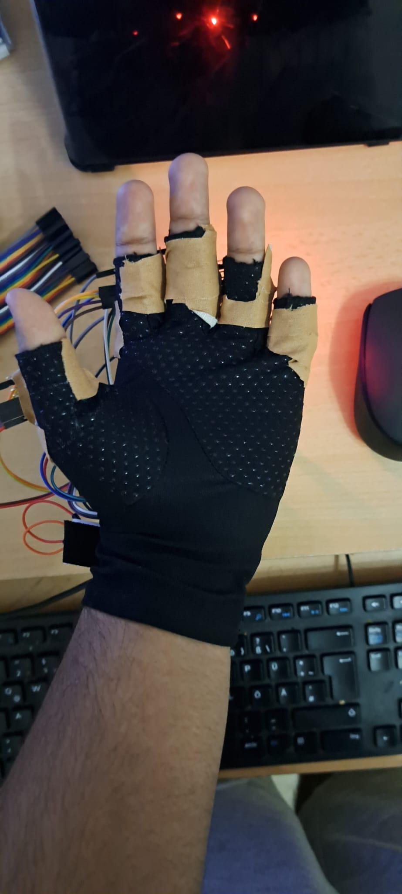
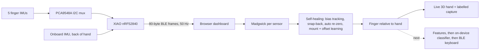
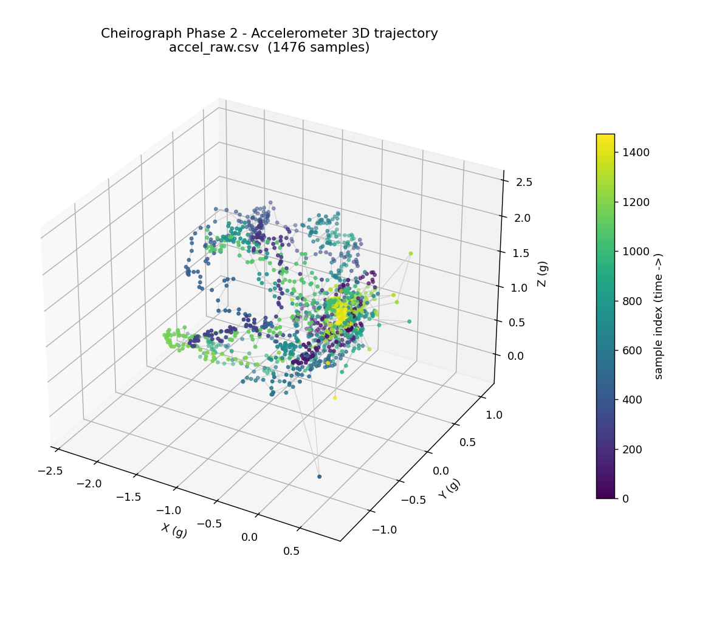
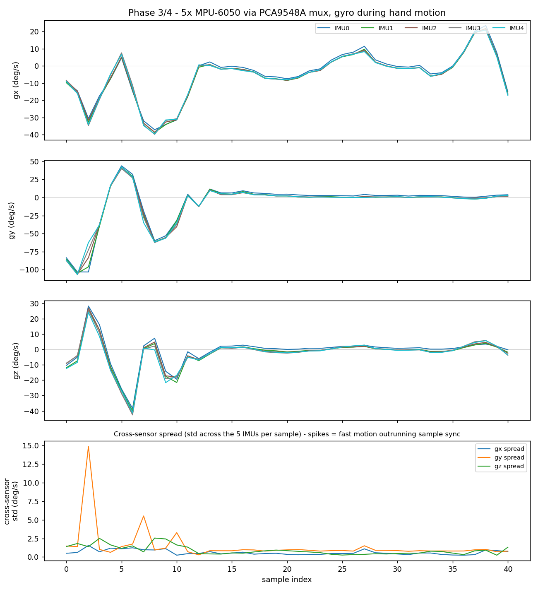
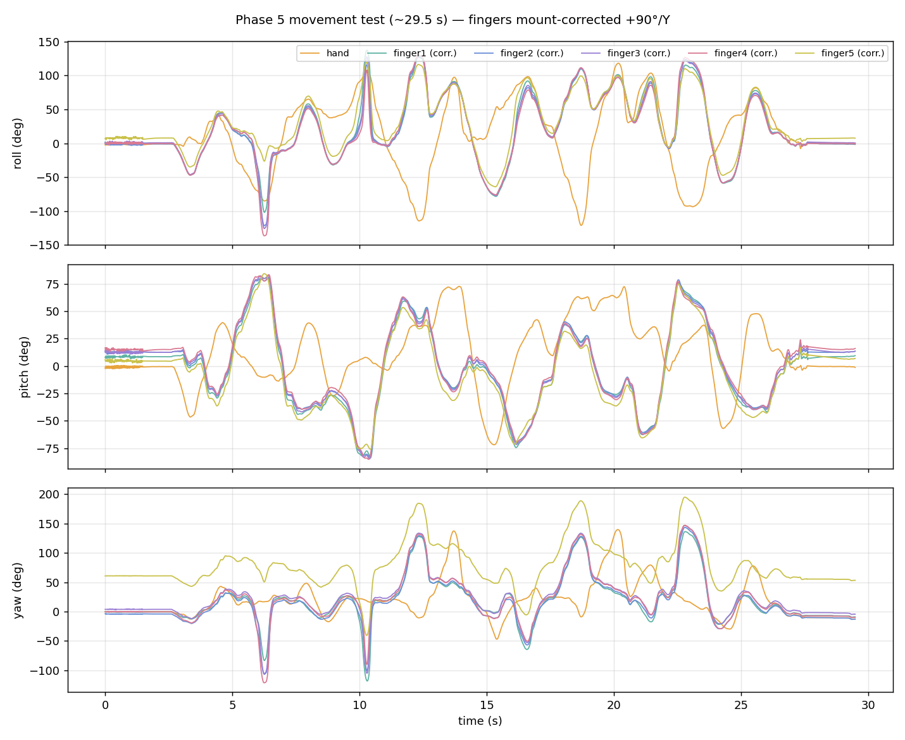

<div align="center">

# Cheirograph

### A glove that reads the shape of your hand.

Six IMUs. One Bluetooth link. A live 3D hand in the browser.
The end goal: a tiny model on the glove's own chip that recognises fingerspelling and types it.

*cheir* (χείρ) = hand &nbsp;·&nbsp; *graph* (γράφω) = writing




-1f6feb)


**[Build log](DOCUMENTATION.md)** · **[Design decisions](DECISIONS.md)** · **[Roadmap](GENERAL_PLAN.md)** · **[Dashboard source](tools/handrig_dashboard.html)** · **[Wiring](hardware/WIRING.md)**

</div>

---

## In one minute

I built a left-hand glove with an IMU on every finger and one on the back of the hand. A microcontroller on the wrist reads all six, packs them into a small binary frame and streams them over Bluetooth at 50 Hz. A browser dashboard turns that into a live 3D hand and records labelled data.

It's a solo project, from soldering to firmware to the frontend. The repo is two things:

1. **The glove**, which works today as a wireless sensing and visualisation system.
2. **The engineering record**: a dated build log, every design decision with its cost, and the bugs that took days. Failures stay in. What works says "works". What I haven't verified says "unverified".

The part still ahead is recognition. I'd rather say that up front than have you find it out.

## At a glance

| | |
|---|---|
| **Sensors** | 5 finger IMUs behind an I²C mux + the XIAO's onboard IMU on the back of the hand |
| **Firmware** | C++ on a Seeed XIAO nRF52840 Sense, raw register-level I²C, bus recovery at runtime |
| **Link** | Bluetooth LE, Nordic UART, 80-byte frames with a validity mask and checksum |
| **Rate** | 50 Hz over the air, ~94 Hz raw on the bench (all six sensors) |
| **Dashboard** | Single HTML file. Web Bluetooth + Three.js. Fusion runs in the browser. No build step |
| **Fusion** | Madgwick per sensor, then `q_rel = conj(q_hand) ⊗ q_finger` |
| **Self-healing** | Bias tracking, snap-back, auto re-zero, live calibration of the hand IMU's mount |
| **Data tooling** | Batch capture, a 13-fault quality gate, a kNN baseline scored leave-one-session-out |
| **Scope** | Fingerspelling and a fixed set of static hand shapes. Not sign language |

## See it

<table>
<tr>
<td width="50%"><br><sub><b>First time all six talked at once.</b> Raw accel vectors from the stage 04 capture, before any fusion.</sub></td>
<td width="50%"><br><sub><b>The first dashboard.</b> It has since been rebuilt around self-calibration. Kept here as the "before".</sub></td>
</tr>
<tr>
<td><br><sub><b>Fingers wired.</b> One sensor on each middle phalanx, thumb on the proximal one. Stranded wire, anchored both sides.</sub></td>
<td><br><sub><b>Back of the hand.</b> The XIAO is the reference sensor. It's held on with velcro, which turned into a real problem (bug 7).</sub></td>
</tr>
</table>

> **Motion-test recordings** (glove video next to the dashboard, before vs after the v5 fixes) exist for all seven tests, T0 to T6. They are too big for git, so they're not in the repo. The protocol, the numbers and the written findings are: [`09-firmware-hardening/motion-tests/`](09-firmware-hardening/motion-tests/).

---

## The one idea

A finger's pose is its orientation **relative to the hand**, not relative to the room.

```
q_rel = conj(q_hand) ⊗ q_finger
```

Wave your whole arm and both quaternions rotate together, so `q_rel` doesn't change. Curl one finger and only `q_finger` moves. That makes `q_rel` the signal a classifier can actually use, because it doesn't care where the hand is pointing. [Stage 06](06-relative-orientation/) works through the math.

## How it works



All five finger sensors share one I²C address, so a multiplexer switches between them. The firmware sends **raw** accel and gyro and does no fusion. The dashboard does the axis remap, the filtering and the calibration. That keeps the chip fast and makes everything replayable from a CSV, which is how most of the bugs below were found.

---

## Status

| Layer | State | Where |
|---|---|---|
| Six IMUs on one I²C bus via a mux | ✅ Works, ~94 Hz measured | [04](04-all-six-imus-raw/) |
| Sensor fusion (Madgwick) per IMU | ✅ Works on the bench | [05](05-madgwick-fusion/) |
| Mounted on a glove | ✅ 30 min wear test passed | [07](07-full-glove-assembly/) |
| Bluetooth stream + live 3D dashboard | ✅ On the glove. v5 firmware: 50 Hz (v4 was ~47 Hz) | [08](08-ble-wireless-dashboard/), [09](09-firmware-hardening/) |
| Finger pose relative to the hand | 🟡 Lives in the dashboard JS, not in firmware | [06](06-relative-orientation/), [tools](tools/) |
| v5 firmware (±2000 °/s, bigger BLE link, runtime fault recovery) | 🟡 Running since 2026-10-31. Fault-recovery paths untested | [09](09-firmware-hardening/) |
| Self-healing dashboard | 🟡 Works on the glove by eye. Motion tests re-run on video, no new CSV numbers yet | [tools](tools/), [motion tests](09-firmware-hardening/motion-tests/) |
| Self-calibrating hand IMU mount | 🟡 Tested on recorded and synthetic data, not yet measured on the glove | [tools](tools/) |
| Thumb rig and flex axis | 🟡 Thumb data is healthy. The 3D thumb sat inside the palm box and its bend was read about the wrong axis. Fixed in the dashboard (2026-11-07), not yet tried on the glove. The flex axis comes from 17 Hz captures, so it needs re-measuring | [tools](tools/) |
| Dataset tooling (quality gate, baseline) | 🟡 Built, tested on synthetic data | [tools](tools/) |
| Labelled dataset | ⬜ Next | [ml](ml/) |
| On-device classifier + BLE keyboard | ⬜ After that | [ml](ml/) |

## Measured results

| What | Result |
|---|---|
| Loop rate, 6 IMUs raw | ~93.6 Hz (target 100) |
| Loop rate with fusion on all 6 | ~85 Hz |
| BLE stream, v4 after the bandwidth fix | ~47 Hz, 3.7 KB/s |
| BLE stream, v5 with link requests | 50 Hz, MTU 527, 15 ms interval, 0 failed sends (firmware serial report) |
| Gyro bias std after calibration | 0.05–0.35 °/s |
| Roll/pitch drift, held still | ≤ 0.35 °/min (line fit, 31.5 s) |
| Yaw drift, held still | 0.03–2.2 °/min. Expected, there's no magnetometer |
| Wear test | 30 min, glove taken off and on, no dropped connection |
| Dataset checker | 13 of 13 planted faults caught |

**What the 2026-10-31 motion tests fixed.** Evidence is serial logs, replays of recorded CSVs and synthetic data. The glove re-run was captured on video only, so the "after" column is not yet re-measured on the glove.

| What | Before | After |
|---|---|---|
| Frame rate over Bluetooth | 16.7 Hz | 50 Hz |
| Gyro range | ±500 °/s, 11–15 % of fast-fist samples clipped | ±2000 °/s |
| Calibration zero error | 17–27 ° on every sensor | within 0.2 ° of a converged filter |
| Pinky accel | read "25–28 % low" | zero-g offset found (0.25, 0.19, −0.17 g), corrected, now also learned live |
| Worst finger error at end of test (replay) | up to 94 ° | under 5 ° in most tests (T2 unchanged) |
| Hand IMU axes | picked by guess, fingers 80–88 ° off the hand's forward | measured from a gyro fit: 2–10 ° |
| Hand IMU stuck on tipped or turned | fingers swing 74–134 ° when only the hand moves | fingers within 0.4 °, palm within 2.4 ° (synthetic test) |

**Not measured yet:** Bluetooth latency, drift over several minutes, and any classifier accuracy on real data.

---

## The bugs that taught me the most

**1. The sensors weren't what the label said.** The "MPU-6050" modules are clones. `WHO_AM_I` returns `0x72`, not `0x68`. They answer on the bus, so every wiring check passes. But the library never sends the wake-up write this chip family needs, so four of five fingers booted half-asleep. They sent plausible values (about 1 g) that were frozen or ramped by an exact step every frame. I found it by reading the raw CSV numerically instead of tuning the filter. Fix: a small register-level driver that reads every config value back after writing it. → [Stage 08](08-ble-wireless-dashboard/), [decision](DECISIONS.md#2026-07-19--raw-register-driver-for-the-clone-finger-imus)

**2. A Bluetooth problem that looked like a sensor problem.** The dashboard connected and sat at 0 Hz. I timed each part of the loop. Sensor reads stayed flat at 5.9 ms, but the BLE write blocked for over 100 ms. The default link config was far below what the chip can do. Widening it got ~47 Hz with no dropped data. → [decision](DECISIONS.md#2026-08-07--widen-the-ble-link-instead-of-shrinking-the-data)

**3. A training-data bug no test would have caught by eye.** The batch export saved each finger relative to its own starting pose, not relative to the hand. The numbers looked fine, but tilting the hand would have changed the finger features in the training set. I caught it in review before any real data existed. → [decision](DECISIONS.md#2026-10-06--batch-export-uses-the-hand-relative-quaternion)

**4. A fix that made things worse.** To keep motion out of calibration I first dropped samples with gyro above 6 °/s. But a still sensor reads its own bias, not zero, and the pinky's bias was above 6 °/s. It never calibrated. The real fix compares each sensor against its own rolling average. → [decision](DECISIONS.md#2026-08-08--calibration-stillness-gate-uses-deviation-not-an-absolute-threshold)

**5. A calibration that could only turn 92 degrees.** After calibration the fingers kept moving and never sat at zero. The dashboard "settled" each filter with 40 small steps, and 40 steps turn about 92° at most. Every sensor started about 100° away, so each zero was off by 17 to 27°. I found it by replaying recorded CSVs. The fix computes the settled orientation directly and matches a converged filter within 0.2°. → [decision](DECISIONS.md#2026-10-31--calibration-settle-in-closed-form)

**6. Two bugs that only showed up once the data was fast enough.** Fingers drifted and didn't come back after big moves. The raw CSVs showed two causes. Gyros sat flat at ±500 °/s during fast moves (11–15 % of samples). And the glove only sent 16.7 frames a second, because the firmware waited on every Bluetooth write over a small default packet size. Clipping alone didn't explain it: the hand IMU never clipped and still lost 24–35°. Fix: ±2000 °/s on all six sensors, plus asking the browser for a bigger link on connect. → [decision](DECISIONS.md#2026-10-31--gyro-full-scale-2000-s)

**7. Up and left swapped on screen.** Tipping my real fingertips up made the 3D hand turn sideways, and turning it made it tip. Roll was fine. That pattern means the dashboard had the hand IMU's "up" axis wrong by 90°. The XIAO is velcroed on and had gone back on tipped. A fixed axis setting can't follow a mount that changes, so the dashboard now measures it: tilt from gravity at every calibration, and the in-plane turn from the gyros while the hand moves. In a synthetic test with the XIAO tipped 90°, the palm matched the real hand within 1.2° right after calibration. → [decision](DECISIONS.md#2026-10-31--hand-imu-tilt-measured-at-calibration-hand-axes-picker-removed)

---

## The build, stage by stage

Each folder is one milestone with its code, raw data, plots and a write-up. Old stages are never deleted, so you can follow the whole path.

| Stage | What it proves | |
|---|---|---|
| [00 LED sanity test](00-led-sanity-test/) | The board flashes and runs code | |
| [01 XIAO onboard IMU](01-xiao-onboard-imu/) | The hand-reference sensor reads clean | |
| [02 Single MPU-6050](02-single-mpu6050/) | One finger sensor works, and it's a clone |  |
| [03 I²C multiplexer](03-i2c-multiplexer/) | Five sensors at the same address share one bus | |
| [04 All six IMUs raw](04-all-six-imus-raw/) | All six read together at ~94 Hz |  |
| [05 Madgwick fusion](05-madgwick-fusion/) | Raw motion becomes orientation, per sensor |  |
| [06 Relative orientation](06-relative-orientation/) | The math behind finger-vs-hand pose | |
| [07 Full glove assembly](07-full-glove-assembly/) | It survives being worn |  |
| [08 BLE wireless dashboard](08-ble-wireless-dashboard/) | Live wireless 3D hand, and the hardest bug | |
| [09 Firmware hardening](09-firmware-hardening/) | 50 Hz over BLE, ±2000 °/s gyro, bus-fault recovery (untested), motion tests before and after | |

## Roadmap

```
 ✅ 0–3   Board, onboard IMU, one finger, I²C mux
 ✅ 4–5   Six IMUs raw at ~94 Hz, Madgwick fusion
 ✅ 6–7   Relative orientation, full glove, wear test
 ✅ 7.5   BLE + live 3D dashboard, firmware v5, self-healing
 🔧 8     Dataset: batch capture, quality gate, baseline  ← tooling done, no real data yet
 ⬜ 9     First labelled sessions, train, leave-one-session-out accuracy
 ⬜ 10    Classifier on the chip (TinyML), BLE HID keyboard
```

Next, in order: re-run the motion tests with the dashboard CSV so the table above gets real numbers, confirm the hand-mount fix and the pinky offset on the glove, record a demo clip, then collect the first labelled dataset. Full order in the [roadmap](GENERAL_PLAN.md#next-steps-in-order).

**Scope, on purpose:** fingerspelling and static hand shapes only. Real signing also needs hand position, motion, both hands and facial expression. Six IMUs on one hand can't capture that, and I won't claim it can.

---

## What this project shows

- **Embedded C++ on a timing budget.** Six sensors, a mux and Bluetooth inside a 20 ms frame.
- **I²C at register level.** Clone-chip init, read-back verification, bus recovery by bit-banging SCL.
- **Sensor fusion.** Quaternions, Madgwick, gyro bias calibration, frame remaps that stay proper rotations.
- **Self-calibration.** Accel offsets from a sphere fit, the hand IMU's mount from gravity plus a closed-form gyro fit. Each checked against recorded data first.
- **Protocol design.** A compact binary frame with a validity mask and checksum, each field added because of a real bug.
- **Debugging with evidence.** Raw CSVs, timing counters and plots before changing code.
- **Frontend.** Web Bluetooth + Three.js, in-browser fusion, data-quality gates.
- **Data tooling and ML prep.** A dataset gate, synthetic data for testing, a kNN baseline with leave-one-session-out.
- **Engineering writing.** A dated log that includes the failures, and a decision record with tradeoffs.

## Hardware

| Part | Role |
|---|---|
| Seeed XIAO nRF52840 Sense | MCU, Bluetooth, onboard IMU as the hand reference |
| 5× MPU-6050 modules (MPU-6500/9250 clones) | One per finger |
| PCA9548A | I²C mux, fixes the address collision |
| Half-finger glove, left hand | Everything mounts on it |

Parts list and wiring: [`hardware/`](hardware/).

## Run it

1. Install the Arduino IDE and add the Seeed board URL (see [Stage 00](00-led-sanity-test/)). Install **Seeed nRF52 Boards 1.1.13** and select **Seeed XIAO nRF52840 Sense**.
2. No port showing up? Double-tap RESET.
3. Open the `.ino` in a stage folder and upload. Serial Monitor at 115200 baud.
4. For the live view, flash [Stage 09](09-firmware-hardening/) (v5) and open [`tools/handrig_dashboard.html`](tools/handrig_dashboard.html) in Chrome or Edge. No server, no build. The dashboard expects v5's ±2000 °/s gyro. v4 (Stage 08) reads 4× too large in it.
5. Connect, press **Calibrate** with the hand flat and fingers straight, then tilt and roll the whole hand for about 2 s. HEALTH shows OK when the mount is checked.

Python tools: `cd tools && pip install -r requirements.txt`. Each script is documented in [`tools/README.md`](tools/README.md).

## Repo map

```
00-led-sanity-test/ … 09-firmware-hardening/   one folder per milestone
tools/        analysis scripts, the dashboard, verify_* tests
hardware/     BOM, wiring, datasheets
ml/           data-collection plan, dataset exports
docs/         media, references
DOCUMENTATION.md   dated build log, newest first
DECISIONS.md       every fork: options, choice, why, cost
GENERAL_PLAN.md    roadmap and next steps
```

## Contributing and license

Questions and ideas are welcome, see [`CONTRIBUTING.md`](CONTRIBUTING.md). MIT license, see [`LICENSE`](LICENSE).
