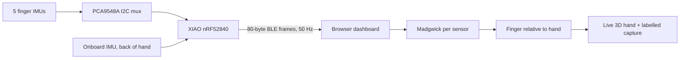

# Cheirograph

**A wearable glove that reads the shape of your hand with six IMUs, streams it over Bluetooth, and renders it live in 3D. The end goal is a small model on the glove's own chip that recognises fingerspelling letters and types them.**

*cheir* (χείρ) = hand, *graph* (γράφω) = writing.

<p align="center">
  
</p>

I'm building this alone, from soldering to firmware to the browser dashboard. The repo holds the code and also the full engineering record: a dated build log, every design decision with its tradeoff, and the bugs that cost me days. I'm keeping it honest on purpose. What works says "works", and what's unverified says "unverified".

**Quick links:** [Build log](DOCUMENTATION.md) · [Design decisions](DECISIONS.md) · [Roadmap](GENERAL_PLAN.md) · [Live dashboard code](tools/handrig_dashboard.html) · [Wiring](hardware/WIRING.md)

---

## Status

| Layer | State | Where |
|---|---|---|
| Six IMUs on one I²C bus via a mux | ✅ Works, ~94 Hz measured | [04](04-all-six-imus-raw/) |
| Sensor fusion (Madgwick) per IMU | ✅ Works on the bench | [05](05-madgwick-fusion/) |
| Mounted on a glove | ✅ Passed a 30 min wear test | [07](07-full-glove-assembly/) |
| Bluetooth stream + live 3D dashboard | ✅ Running on the glove, ~47 Hz | [08](08-ble-wireless-dashboard/) |
| Finger pose relative to the hand | 🟡 In the dashboard, not yet in firmware | [06](06-relative-orientation/), [tools](tools/) |
| Runtime fault recovery (v5 firmware) | 🟡 Flashed 2026-10-31, recovery paths untested | [09](09-firmware-hardening/) |
| Self-healing dashboard (snap-back, auto re-zero, live offset learning) | 🟡 Works on the glove by eye. Motion tests not re-run yet | [tools](tools/) |
| Dataset tooling (quality gate, baseline model) | 🟡 Built, tested on synthetic data | [tools](tools/) |
| Labelled dataset | ⬜ Next | [ml](ml/) |
| On-device classifier + Bluetooth keyboard | ⬜ After that | [ml](ml/) |

Right now it's a working sensing and visualisation system. Recognition is the part still ahead.

## Measured results

| What | Result |
|---|---|
| Loop rate, 6 IMUs raw | ~93.6 Hz (target 100) |
| Loop rate with fusion on all 6 | ~85 Hz |
| Bluetooth stream after the bandwidth fix | ~47 Hz, 3.7 KB/s (target 50) |
| Gyro bias std after calibration | 0.05–0.35 °/s |
| Roll/pitch drift, held still | ≤ 0.35 °/min (line fit, 31.5 s) |
| Yaw drift, held still | 0.03–2.2 °/min. Expected: no magnetometer |
| Wear test | 30 min, glove taken off and on, no dropped connection |
| Dataset checker | 13/13 planted faults caught |

Fixes from the 2026-10-31 motion tests (serial and replay evidence, not yet re-measured on the glove):

| What | Before | After |
|---|---|---|
| Frame rate over Bluetooth | 16.7 Hz | 50 Hz (serial report, MTU 527, 15 ms interval) |
| Gyro range | ±500 °/s, 11–15 % of fast-fist samples clipped | ±2000 °/s |
| Calibration zero error | 17–27 ° on every sensor | within 0.2 ° of a converged filter |
| Pinky accel | read "25–28 % low" | fixed zero-point offset found (0.25, 0.19, -0.17 g) and corrected |
| Worst finger error at end of test (replay) | up to 94 ° | under 5 ° in most tests (T2 unchanged) |

Not measured yet: Bluetooth latency, drift over several minutes, and any classifier accuracy on real data.

## How it works



All five finger sensors share the same I²C address, so a multiplexer switches between them. The board's own IMU sits flat on the back of the hand as the reference.

The one idea the project rests on: a finger's pose is its orientation **relative to the hand**, not relative to the room.

```
q_rel = conj(q_hand) ⊗ q_finger
```

Wave your arm and both quaternions rotate together, so `q_rel` stays put. Curl a finger and only `q_finger` moves. That's what makes the signal usable for classification. [Stage 06](06-relative-orientation/) explains it.

**Scope:** fingerspelling and a fixed set of static hand shapes. Not sign language. Real signing also needs hand position, motion, both hands and facial expression, and six IMUs on one hand can't capture any of that.

## The bugs that taught me the most

**1. The sensors weren't what the label said.** The "MPU-6050" modules are clones. Their `WHO_AM_I` register returns `0x72`, not `0x68`. They answer on the bus, so every wiring check passes. But the library never sends the wake-up write this chip family needs, so four of five fingers booted half-asleep. They sent values that looked plausible (about 1 g) but were frozen or ramped by an exact step every frame. I found it by reading the raw CSV numerically instead of tuning the filter. I replaced the library with a small register-level driver that reads every config value back after writing it. → [Stage 08](08-ble-wireless-dashboard/), [decision](DECISIONS.md#2026-07-19--raw-register-driver-for-the-clone-finger-imus)

**2. A Bluetooth problem that looked like a sensor problem.** The dashboard connected and sat at 0 Hz. I timed each part of the loop. Sensor reads stayed flat at 5.9 ms, but the BLE write call blocked for over 100 ms. The default link config was far below what the chip can do. Widening it got ~47 Hz without dropping any data. → [decision](DECISIONS.md#2026-08-07--widen-the-ble-link-instead-of-shrinking-the-data)

**3. A training-data bug no test would have caught by looking.** The batch export saved each finger relative to its own starting pose instead of relative to the hand. The numbers looked fine, but tilting your hand would have changed the finger features in the training set. I caught it in a code review before any real data was collected. → [decision](DECISIONS.md#2026-10-06--batch-export-uses-the-hand-relative-quaternion)

**4. A fix that made things worse.** To keep motion out of calibration, I first dropped samples with gyro above 6 °/s. But a still sensor reads its own bias, not zero, and the pinky's bias was above 6 °/s. It never calibrated. The real fix compares each sensor against its own rolling average. → [decision](DECISIONS.md#2026-08-08--calibration-stillness-gate-uses-deviation-not-an-absolute-threshold)

**5. A calibration that could only turn 92 degrees.** After calibration the fingers kept moving and never sat at zero. The dashboard "settled" each filter with 40 small steps, and 40 steps can turn about 92 deg at most. Every sensor started about 100 deg away, so each zero was off by 17 to 27 deg. I found it by replaying the recorded CSVs. The fix computes the settled orientation directly, and it matches a converged filter within 0.2 deg. → [decision](DECISIONS.md#2026-10-31--calibration-settle-in-closed-form)

## The build, stage by stage

Each folder is one milestone with its code, raw data, plots and a write-up. Old stages are never deleted, so you can follow the whole path.

| Stage | What it proves |
|---|---|
| [00 LED sanity test](00-led-sanity-test/) | The board flashes and runs code |
| [01 XIAO onboard IMU](01-xiao-onboard-imu/) | The hand-reference sensor reads clean |
| [02 Single MPU-6050](02-single-mpu6050/) | One finger sensor works, and it's a clone |
| [03 I²C multiplexer](03-i2c-multiplexer/) | Five sensors at the same address share one bus |
| [04 All six IMUs raw](04-all-six-imus-raw/) | All six read together at ~94 Hz |
| [05 Madgwick fusion](05-madgwick-fusion/) | Raw motion becomes orientation, per sensor |
| [06 Relative orientation](06-relative-orientation/) | The math behind finger-vs-hand pose |
| [07 Full glove assembly](07-full-glove-assembly/) | It survives being worn |
| [08 BLE wireless dashboard](08-ble-wireless-dashboard/) | Live wireless 3D hand, and the hardest bug |
| [09 Firmware hardening](09-firmware-hardening/) | Recovers from bus faults without a reboot (not flashed yet) |

## What this project shows

- **Embedded C++ on a timing budget.** Six sensors, a mux and Bluetooth inside a 20 ms frame.
- **I²C at register level.** Clone-chip init, read-back verification, bus recovery by bit-banging SCL.
- **Sensor fusion.** Quaternions, Madgwick, gyro bias calibration, coordinate-frame remaps that stay proper rotations.
- **Protocol design.** A compact binary BLE frame with a validity mask and checksum, each added because of a real bug.
- **Debugging with evidence.** Raw CSVs, timing counters and plots before changing code.
- **Frontend.** A Web Bluetooth dashboard with Three.js, in-browser fusion and data-quality gates.
- **Data tooling and ML prep.** A dataset quality gate, synthetic data for testing, and a kNN baseline scored with leave-one-session-out.
- **Engineering writing.** A dated log that includes the failures, and a decision record with tradeoffs.

## Hardware

| Part | Role |
|---|---|
| Seeed XIAO nRF52840 Sense | MCU, Bluetooth, onboard IMU as the hand reference |
| 5× MPU-6050 modules (MPU-6500/9250 clones) | One per finger |
| PCA9548A | I²C mux, fixes the address collision |
| Half-finger glove, left hand | Everything mounts on it |

Parts list and wiring: [`hardware/`](hardware/).

## Run it

1. Install the Arduino IDE and add the Seeed board URL (see [Stage 00](00-led-sanity-test/)). Install **Seeed nRF52 Boards 1.1.13** and select **Seeed XIAO nRF52840 Sense**.
2. No port showing up? Double-tap RESET.
3. Open the `.ino` in a stage folder and upload. Serial Monitor at 115200 baud.
4. For the live view, flash [Stage 08](08-ble-wireless-dashboard/) and open [`tools/handrig_dashboard.html`](tools/handrig_dashboard.html) in Chrome or Edge. No server or build step.

Python tools: `cd tools && pip install -r requirements.txt`. Each script is documented in [`tools/README.md`](tools/README.md).

## What's next

Flash and test the v5 firmware on the glove, fix the pinky sensor, record a demo clip, then collect the first real labelled dataset and train the classifier. Full order in the [roadmap](GENERAL_PLAN.md#next-steps-in-order).

## Contributing and license

Questions and ideas are welcome, see [`CONTRIBUTING.md`](CONTRIBUTING.md). MIT license, see [`LICENSE`](LICENSE).
